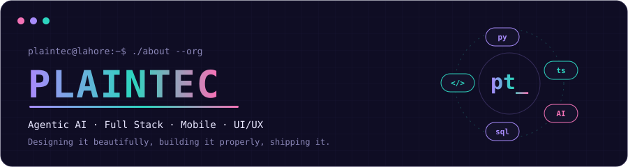

---

##  About

**PlainTech** is a small engineering studio led by [Eman Fatima](https://github.com/emanfatima72). We build practical software with a focus on agentic AI, full-stack web, mobile apps and clean UI/UX, and we write about what we learn along the way.

---

##  Focus Areas

| Area | What we work on |
| --- | --- |
| **Agentic AI** | LangChain and LangGraph workflows, tool-using agents, prompt engineering |
| **Backend** | Python, FastAPI, PostgreSQL, SQLite, MongoDB, Oracle |
| **Web and Mobile** | React, Next.js, TypeScript, Flutter |
| **Automation and Security** | Playwright automation, Kali Linux, Metasploit |
| **Design** | Figma, UI/UX, design systems |

---

##  Projects

---

##  Connect

